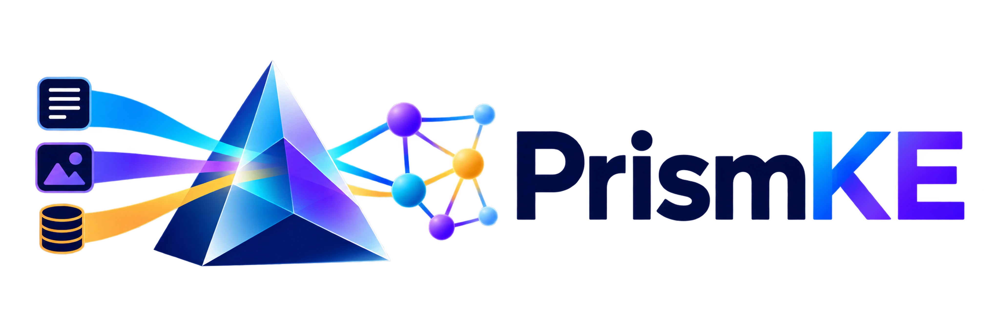
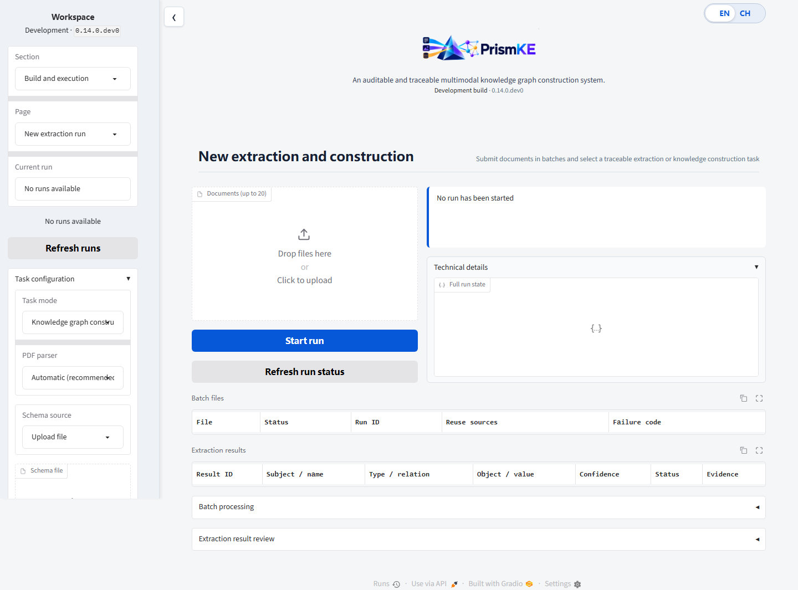

# PrismKE

<div align="center">
  

  <p><strong>Schema-guided, evidence-aware multimodal knowledge graph construction</strong></p>

  <p>
    <a href="README.md">English</a> |
    <a href="README.zh-CN.md">简体中文</a>
  </p>

  <p>
    
    
    
    
  </p>
</div>

PrismKE is a research-oriented framework for building multimodal knowledge graphs from
heterogeneous documents. It combines schema-guided extraction, traceable evidence,
human review, entity governance, conflict detection, and versioned graph commits in one
auditable workflow.

The latest development version is **0.14.0.dev0** on `dev/v0.14`; the latest stable
release remains **v0.13.1** on `main` in the upstream repository. The workflow protocol
remains `0.13.0`. Runs created by older protocol versions should be resumed with their
corresponding release.

## Table of Contents

- [News](#news)
- [Overview](#overview)
- [Core Capabilities](#core-capabilities)
- [Workflow](#workflow)
- [Quick Start](#quick-start)
- [Further Usage](#further-usage)
  - [Task Modes](#task-modes)
  - [Evaluation and Result Export](#evaluation-and-result-export)
  - [Supported Inputs](#supported-inputs)
  - [Model Providers](#model-providers)
  - [OCR and Visual Extraction](#ocr-and-visual-extraction)
  - [High-Fidelity PDF Parsing](#high-fidelity-pdf-parsing)
  - [Entity Linking and Governance](#entity-linking-and-governance)
  - [Neo4j and the Web Workspace](#neo4j-and-the-web-workspace)
- [Project Layout](#project-layout)
- [Development](#development)
- [Documentation](#documentation)
- [Current Boundaries](#current-boundaries)
- [Acknowledgements](#acknowledgements)

## News

- **2026/11 — v0.14 development:** added reproducible public/synthetic data tooling,
  Twitter-2017 and MNRE-V2 evaluation pipelines, shared vanilla baselines, component
  ablations, agent-progression studies, structured result projection, and export
  artifacts.
- **2026/10 — v0.14 development:** added an English-first research workspace with
  instant EN/CH switching. Display language changes do not alter API enums, audit data,
  run snapshots, or graph contents.
- **2026/10 — v0.13.1:** refined Chinese error notifications, category rendering, and
  empty states for dynamic selectors.
- **v0.13:** introduced a queryable, reviewable, and versioned media knowledge layer.
  Visual-only assertions require explicit human approval before graph commit.
- **v0.12:** added two-tier PDF parsing with PyMuPDF and MinerU, including auditable
  routing decisions, derived-asset manifests, and operator-controlled fallback.
- **v0.11:** added multi-document batches and six task modes, from extraction-only jobs
  to complete knowledge graph construction.
- **v0.10:** established three semantic agents for multimodal extraction, entity and
  fact governance, and fusion review, while retaining deterministic validation and
  transactional graph commits.

See [CHANGELOG.md](CHANGELOG.md) for the complete release history.

## Overview

Knowledge extraction becomes difficult when the source material mixes text, scans,
figures, office documents, and conflicting statements. PrismKE treats extraction as a
governed process rather than a single model call:

- every claim points back to independently verifiable evidence;
- schema constraints are enforced before data reaches the graph;
- uncertain entities, conflicting facts, and visual-only assertions enter review queues;
- model-assisted suggestions remain bounded by explicit budgets and hard validation;
- graph changes are committed as immutable revisions and can be compensated later.

PrismKE supports local JSON storage for lightweight experiments and Neo4j for searchable
graph deployments. The same workflow is available through a CLI, an HTTP API, and an
English/Chinese Gradio research workspace. The v0.14 development line also provides
reproducible dataset preparation, benchmark evaluation, ablation, agent-progression, and
portable result-export tooling.



## Core Capabilities

| Area | What PrismKE provides |
| --- | --- |
| Multimodal ingestion | TXT, Markdown, HTML, JSON, DOC/DOCX, PDF, PNG, JPEG, WebP, TIFF, and BMP |
| Schema guidance | Entity and relation aliases, domain/range, cardinality, symmetry, inverse relations, and strict mode |
| Evidence lineage | SHA-256-addressed source files, localized evidence references, parser metadata, and derived-asset provenance |
| Extraction | OpenAI-compatible text and vision providers plus deterministic mock providers |
| Governance | Entity linking, canonicalization, merge/split proposals, conflict sets, risk routing, and human review |
| Media knowledge | Versioned media content and occurrences, `DEPICTS`/`SUPPORTS` relations, and reviewed visual assertions |
| Reliability | LangGraph checkpoints, resumable runs, request reuse, bounded reflection, cancellation, and recovery controls |
| Evaluation and export | Reproducible dataset manifests, Twitter-2017/MNRE-V2 pipelines, shared baselines, ablations, agent progression, structured projections, and export artifacts |
| Storage | Atomic local JSON GraphStore or Neo4j with revision history and compensating rollback |
| Interfaces | Typer CLI, FastAPI under `/api/v1`, and an instant-switching EN/CH Gradio workspace under `/ui` |

## Workflow

```text
ingest
  -> parse_document
  -> materialize_visual_assets
  -> run_ocr
  -> persist_evidence
  -> load_schema
       |-> extract_text_claims ---|
       |-> extract_visual_claims -|-> align_modalities
  -> validate_candidates
  -> retrieve_cases
  -> bounded_reflection
  -> validate_candidates
  -> resolve_entities
       |-> route_entity_reviews -> human decision -> resume
  -> normalize_claims
  -> detect_conflicts
  -> route_by_risk
  -> prepare_graph_commit
  -> commit_graph
```

Text and visual extraction are checkpointed independently. Recovery does not repeat a
completed branch. Extraction-only task modes stop before graph commit; only
`knowledge_graph_construction` proceeds through cross-document governance and commit.

## Quick Start

### 1. Requirements

- Python **3.11** (`>=3.11,<3.12`)
- [uv](https://docs.astral.sh/uv/)
- Git

Optional components are documented in the sections below. GPU hardware is not required
for the mock-provider walkthrough.

### 2. Clone and install

```bash
git clone https://github.com/wanqian-bjtu/PrismKE.git
cd PrismKE

python -m pip install uv
uv sync
```

> **Windows path note:** Python 3.11 may fail to read an editable-install `.pth`
> file when the repository path contains non-ASCII characters. For that environment,
> recreate the virtual environment with `uv venv --clear --python 3.11`, use
> `uv sync --no-editable`, and add `--no-editable` to `uv run` commands. For
> repository-root tests, use `uv run --no-editable python -m pytest` so the local
> `data` package remains importable. For development, an ASCII-only checkout path
> keeps the normal editable workflow.

Install extras only for the features you need:

```bash
# Development tools and tests
uv sync --extra dev

# Evaluation reports
uv sync --extra evaluation

# FastAPI + Gradio workspace
uv sync --extra web

# Neo4j graph backend
uv sync --extra neo4j

# PaddleOCR
uv sync --extra ocr

# BGE-M3 entity linking (Linux/CUDA environment)
uv sync --extra embedding
```

Extras can be combined, for example:

```bash
uv sync --extra dev --extra web --extra neo4j
```

### 3. Run an offline example

Validate the example schema:

```bash
uv run prismke validate-schema configs/schemas/example.yaml
```

Run the complete workflow with deterministic mock providers:

```bash
uv run prismke run examples/sample.md \
  --schema configs/schemas/example.yaml \
  --provider mock
```

The command prints a `run_id`. Inspect the persisted state with:

```bash
uv run prismke show-run RUN_ID
```

### 4. Start the research workspace

```bash
uv sync --extra web
uv run prismke serve
```

Open:

- Web workspace: <http://127.0.0.1:8000/ui>
- HTTP API: <http://127.0.0.1:8000/api/v1>

## Further Usage

### Task Modes

PrismKE exposes six task modes through the CLI, API, and web workspace:

| Task mode | Purpose | Graph commit |
| --- | --- | :---: |
| `entity_extraction` | Extract typed entity mentions | No |
| `relation_extraction` | Extract relations using provided or automatically detected entities | No |
| `schema_information_extraction` | Extract schema-defined attributes and events | No |
| `joint_entity_relation_extraction` | Extract entities and relations together | No |
| `joint_entity_relation_disambiguation` | Extract and resolve canonical entities | No |
| `knowledge_graph_construction` | Run the complete governed workflow and prepare a graph revision | Yes |

Example:

```bash
uv run prismke run examples/sample.md \
  --schema configs/schemas/example.yaml \
  --provider mock \
  --task-mode entity_extraction \
  --output runtime/results/entities.json
```

Run a multi-document batch:

```bash
uv run prismke run-batch examples/a.pdf examples/b.docx examples/c.json \
  --schema configs/schemas/example.yaml \
  --provider mock \
  --task-mode joint_entity_relation_extraction \
  --output runtime/results/batch.json
```

The default batch limits are 20 files, 200 MiB per file, and 500 MiB in total. One failed
file does not discard successful sibling results, but it blocks batch fusion until the
failure is retried or explicitly excluded with an operator reason.

### Evaluation and Result Export

The v0.14 development line adds reproducible data and evaluation tooling. Synthetic
multimodal documents are committed with their generators; redistributable public
materials and restricted benchmarks are governed by source, license, provenance, and
SHA-256 manifests.

```bash
# Rebuild and verify the committed synthetic dataset
uv run python data/tools/generate_synthetic.py
uv run python data/tools/verify_dataset.py --strict

# Inspect the benchmark and study CLIs
uv run prismke twitter2017 --help
uv run prismke mnre-v2 --help
uv run prismke shared-vanilla --help
uv run prismke component-ablation --help
uv run prismke agent-progression --help
```

Benchmark source data is not automatically redistributed. Follow
[`data/README.md`](data/README.md) for license acceptance, local paths, fixed splits,
checksums, case-library exclusions, and leakage controls.

Completed runs can be projected into structured entities, mentions, relations,
attributes, events, media, evidence, and validation records. The web API exports a
portable artifact package from:

```text
GET /api/v1/runs/{run_id}/export
```

Source documents are excluded by default and are included only when
`include_source=true` is requested. Export packages do not contain API keys, database
passwords, absolute local paths, raw provider requests, or checkpoint internals.

### Supported Inputs

| Input | Processing notes |
| --- | --- |
| TXT / Markdown | Preserves text structure; Markdown images can become traceable visual assets |
| HTML | Extracts text and local image context; remote images are disabled by default |
| JSON | Expands scalar values by JSONPath while preserving array order |
| PrismKE DocumentIR JSON | Loads the portable intermediate representation directly |
| DOCX | Extracts paragraphs and embedded images with nearby context |
| DOC | Converts to DOCX through isolated LibreOffice headless execution |
| PDF | Routes between PyMuPDF and MinerU according to recorded complexity signals |
| PNG / JPEG / WebP / TIFF / BMP | Supports OCR and vision-model processing |

Remote assets are fetched only when `--allow-remote-assets` is set. Decorative images
smaller than `64 x 64` pixels are skipped by default.

### Model Providers

Copy the example environment file and keep real secrets in the untracked `.env` file:

```bash
cp .env.example .env
```

PowerShell equivalent:

```powershell
Copy-Item .env.example .env
```

Configure an OpenAI-compatible text endpoint:

```dotenv
PRISMKE_LLM_BASE_URL=https://your-endpoint.example/v1
PRISMKE_LLM_API_KEY=your-api-key
PRISMKE_LLM_MODEL=your-model
```

Then run:

```bash
uv run prismke run INPUT \
  --schema configs/schemas/example.yaml \
  --provider openai-compatible
```

PrismKE never falls back silently to a mock provider. If a real provider is selected but
its configuration is missing, the run fails explicitly.

### OCR and Visual Extraction

OCR and VLM settings are independent from the text-model settings:

```dotenv
PRISMKE_OCR_DEVICE=auto
PRISMKE_OCR_LANG=mixed
PRISMKE_OCR_MODEL=PP-OCRv5

PRISMKE_VLM_BASE_URL=https://your-endpoint.example/v1
PRISMKE_VLM_API_KEY=your-api-key
PRISMKE_VLM_MODEL=your-vision-model
PRISMKE_VLM_TIMEOUT=120
```

```bash
uv run prismke run INPUT \
  --schema configs/schemas/example.yaml \
  --provider openai-compatible \
  --ocr-provider paddle \
  --vlm-provider openai-compatible
```

For structural testing without external calls, use `--ocr-provider mock` and
`--vlm-provider mock`.

### High-Fidelity PDF Parsing

PrismKE first inspects PDFs with PyMuPDF. Text-oriented documents stay on the lightweight
path; scan-heavy, table-heavy, drawing-heavy, or multi-column documents can be routed to
a local MinerU 4.0.12 Standard service. MinerU is installed in a separate environment.

On Linux:

```bash
bash scripts/install_mineru.sh
bash scripts/start_mineru.sh
bash scripts/status_mineru.sh
```

Stop the service with:

```bash
bash scripts/stop_mineru.sh
```

The service listens on `127.0.0.1:18020` by default. See
[the PDF parsing guide](docs/PrismKE-v0.12双层PDF解析架构与操作.md) for routing,
evidence, fallback, and operational boundaries.

### Entity Linking and Governance

PrismKE can use local BGE-M3 embeddings and a Neo4j vector index for entity retrieval.
The model is pinned by revision and must be prepared explicitly:

```bash
uv run prismke prepare-model --embedding BAAI/bge-m3
uv run prismke rebuild-entity-index --backend neo4j --batch-size 32 --dry-run
uv run prismke rebuild-entity-index --backend neo4j --batch-size 32
```

High-confidence matches can be linked automatically. Ambiguous matches, same-name
cross-type entities, merge proposals, and split proposals remain auditable and require
the configured review policy.

Review and resume a run:

```bash
uv run prismke review RUN_ID --claim-id CLAIM_ID --decision approve
uv run prismke resume RUN_ID
```

### Neo4j and the Web Workspace

For a local service installation:

```bash
uv sync --extra web --extra neo4j
uv run prismke serve
```

For Docker Compose, create `.env`, set at least
`PRISMKE_NEO4J_PASSWORD` and `PRISMKE_API_TOKEN`, then run:

```bash
docker compose up --build
```

The Compose deployment binds the API and Neo4j ports to loopback on the host. Do not
expose PrismKE publicly without authentication, TLS termination, and an appropriate
production task boundary.

Migrate a local JSON graph after a dry run:

```bash
uv run prismke migrate-graph \
  --from-json runtime/graph/graph.json \
  --to neo4j \
  --dry-run

uv run prismke migrate-graph \
  --from-json runtime/graph/graph.json \
  --to neo4j
```

## Project Layout

```text
PrismKE/
├── assets/          # Branding and packaged assets
├── configs/         # Example schemas and service configuration
├── data/            # Synthetic/public data tooling, manifests, and benchmark metadata
├── docs/            # Architecture, operations, and acceptance documentation
├── examples/        # Reproducible inputs and evaluation manifests
├── frontend/        # Gradio research workspace
├── scripts/         # Service, installation, and validation helpers
├── src/             # Core package, workflow, providers, governance, and API
├── tests/           # Unit, integration, browser, and regression tests
├── .env.example     # Safe configuration template
├── docker-compose.yml
├── Dockerfile
├── pyproject.toml
└── uv.lock
```

Runtime data is written under `runtime/` and is intentionally excluded from Git:

```text
runtime/
├── checkpoints.sqlite3
├── evidence/
├── assets/
├── graph/
└── runs/
```

## Development

```bash
uv sync --extra dev --extra web --extra neo4j --extra evaluation
uv run ruff check .
uv run mypy src
uv run pytest -m "not browser"
```

Browser tests additionally require a local Playwright Chromium installation:

```bash
uv run playwright install chromium
uv run pytest -m browser
```

Other test groups may require LibreOffice or a dedicated live Neo4j instance. Pytest
markers identify these external requirements.

## Documentation

- [v0.14 bilingual workspace acceptance](docs/PrismKE-v0.14双语界面验收.md)
- [Dataset, provenance, and benchmark guide](data/README.md)
- [v0.13 media knowledge layer](docs/PrismKE-v0.13媒体知识图层架构.md)
- [v0.13 visual review operations](docs/PrismKE-v0.13视觉审核操作说明.md)
- [v0.13 media API and error codes](docs/PrismKE-v0.13媒体API与错误代码.md)
- [v0.12 two-tier PDF parsing](docs/PrismKE-v0.12双层PDF解析架构与操作.md)
- [Deployment and operations](docs/PrismKE-v0.3-部署与操作.md)
- [Full changelog](CHANGELOG.md)

## Current Boundaries

PrismKE is a research preview. The current release does not yet provide:

- general semantic interpretation of arbitrary tables and charts;
- local VLM execution as a packaged backend;
- production-grade multi-tenancy or fine-grained authorization;
- a public-internet task queue and hardened deployment profile.

Images are evidence assets by default, not domain entities. A vision model produces
`VisualObservation` records; only reviewed domain objects and assertions can enter the
knowledge graph.

## Acknowledgements

PrismKE builds on the open-source ecosystems around
[LangGraph](https://github.com/langchain-ai/langgraph),
[PyMuPDF](https://github.com/pymupdf/PyMuPDF),
[MinerU](https://github.com/opendatalab/MinerU),
[PaddleOCR](https://github.com/PaddlePaddle/PaddleOCR),
[Neo4j](https://neo4j.com/), and
[BGE-M3](https://huggingface.co/BAAI/bge-m3).

The project metadata declares the Apache License 2.0 in
[`pyproject.toml`](pyproject.toml).
