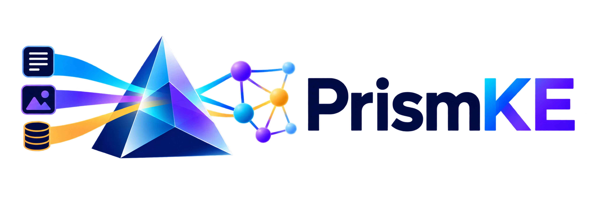
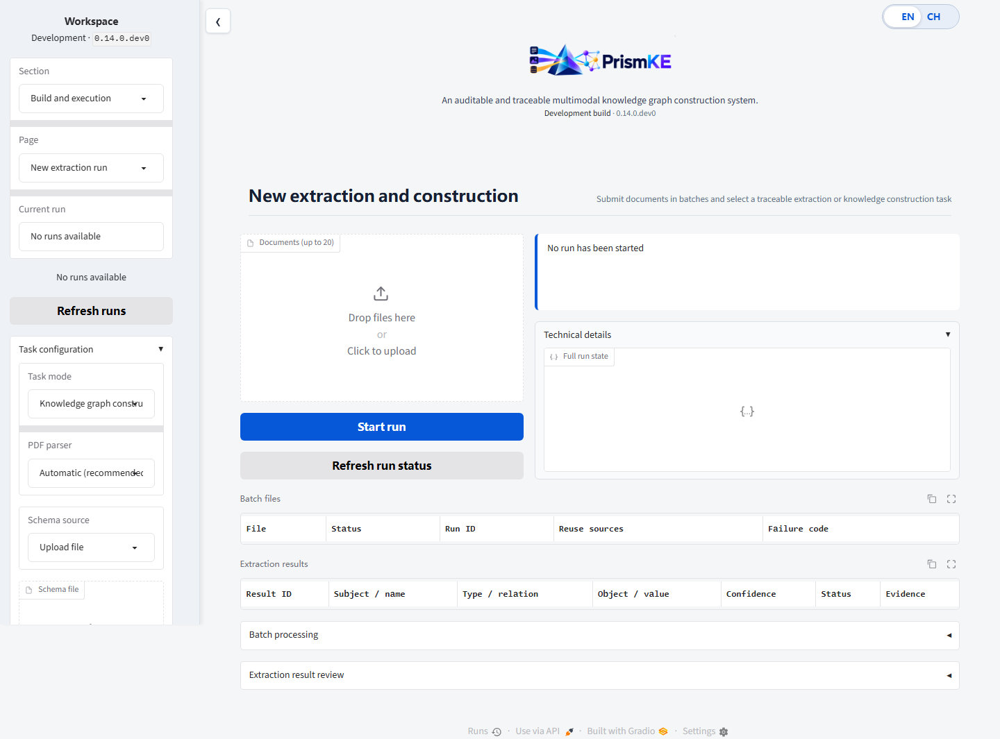

# PrismKE

<div align="center">
  

  <p><strong>模式引导、证据感知的多模态知识图谱构建框架</strong></p>

  <p>
    <a href="README.md">English</a> |
    <a href="README.zh-CN.md">简体中文</a>
  </p>

  <p>
    
    
    
    
  </p>
</div>

PrismKE 是一个面向异构文档的研究型多模态知识图谱构建框架。它把模式引导抽取、
可追溯证据、人工审核、实体治理、冲突检测和版本化图提交组织在同一条可审计流程中。

当前公开版本为本仓库 `main` 分支上的 **0.14.0.dev0**。工作流协议版本仍为
`0.13.0`。由旧协议创建的运行应继续使用对应发布版本恢复。

## 目录

- [最新动态](#最新动态)
- [项目概览](#项目概览)
- [核心能力](#核心能力)
- [处理流程](#处理流程)
- [快速开始](#快速开始)
- [进阶使用](#进阶使用)
  - [任务模式](#任务模式)
  - [评测与结果导出](#评测与结果导出)
  - [输入格式](#输入格式)
  - [模型服务配置](#模型服务配置)
  - [OCR 与视觉抽取](#ocr-与视觉抽取)
  - [高精度 PDF 解析](#高精度-pdf-解析)
  - [实体链接与治理](#实体链接与治理)
  - [Neo4j 与 Web 工作台](#neo4j-与-web-工作台)
- [仓库内容与复现边界](#仓库内容与复现边界)
- [项目结构](#项目结构)
- [开发检查](#开发检查)
- [项目文档](#项目文档)
- [当前边界](#当前边界)
- [致谢](#致谢)

## 最新动态

- **2026/11 — v0.14 开发版：** 新增可复现的公开/合成数据工具、Twitter-2017 与
  MNRE-V2 评测流程、共享 Vanilla Baseline、组件消融、Agent 演进实验、结构化结果投影
  和评测产物导出。
- **2026/10 — v0.14 开发版：** 新增默认英文、可即时切换 EN/CH 的研究工作台；展示
  语言不会改变 API 枚举、审计数据、运行快照或图谱内容。
- **2026/10 — v0.13.1：** 完善中文错误通知、分类展示和动态选择器空状态。
- **v0.13：** 新增可查询、可审核、可版本化的媒体知识层；视觉独有断言必须经过
  人工审核后才能写入图谱。
- **v0.12：** 新增 PyMuPDF 与 MinerU 双层 PDF 解析，并记录可审计的路由决策、
  派生资产清单和由操作者控制的降级过程。
- **v0.11：** 新增多文档批次和六种任务模式，覆盖独立抽取到完整知识图谱构建。
- **v0.10：** 建立多模态抽取、实体与事实治理、融合审核三个语义 Agent，同时保留
  确定性校验和事务化图提交。

完整发布记录见 [CHANGELOG.md](CHANGELOG.md)。

## 项目概览

当输入材料同时包含正文、扫描页、图片、Office 文档和相互冲突的陈述时，知识抽取
不能只依赖一次模型调用。PrismKE 将抽取设计为受治理的完整过程：

- 每条 Claim 都能回溯到可独立校验的证据；
- 数据写图前必须通过 Schema 硬约束；
- 模糊实体、冲突事实和视觉独有断言进入独立审核队列；
- 模型建议受显式预算限制，并且不能绕过确定性校验；
- 图谱变更以不可变 Revision 提交，后续可通过补偿操作回滚。

PrismKE 既支持适合轻量研究的本地 JSON 存储，也支持可查询部署的 Neo4j。CLI、
HTTP API 和支持中英文即时切换的 Gradio 研究工作台共享同一套工作流。v0.14 开发线
还提供可复现数据准备、基准评测、消融实验、Agent 演进分析和可移植结果导出工具。



## 核心能力

| 领域 | PrismKE 提供的能力 |
| --- | --- |
| 多模态输入 | TXT、Markdown、HTML、JSON、DOC/DOCX、PDF、PNG、JPEG、WebP、TIFF、BMP |
| Schema 引导 | 实体/关系别名、domain/range、基数、对称关系、逆关系和严格模式 |
| 证据链路 | SHA-256 内容寻址、局部证据引用、解析器元数据和派生资产溯源 |
| 知识抽取 | OpenAI-compatible 文本/视觉 Provider 与确定性 Mock Provider |
| 知识治理 | 实体链接、规范化、合并/拆分建议、冲突集合、风险路由和人工审核 |
| 媒体知识 | 版本化媒体内容与出现位置、`DEPICTS`/`SUPPORTS` 关系和审核后的视觉断言 |
| 运行可靠性 | LangGraph 检查点、断点恢复、请求复用、受预算约束的 Reflection、安全取消和恢复 |
| 评测与导出 | 可复现数据清单、Twitter-2017/MNRE-V2 流程、共享基线、组件消融、Agent 演进、结构化投影和评测产物 |
| 图谱存储 | 原子更新的本地 JSON GraphStore 或带版本历史与补偿回滚的 Neo4j |
| 使用接口 | Typer CLI、`/api/v1` 下的 FastAPI、`/ui` 下可即时切换 EN/CH 的 Gradio 工作台 |

## 处理流程

```text
ingest
  -> parse_document
  -> materialize_visual_assets
  -> run_ocr
  -> persist_evidence
  -> load_schema
       |-> extract_text_claims ---|
       |-> extract_visual_claims -|-> align_modalities
  -> validate_candidates
  -> retrieve_cases
  -> bounded_reflection
  -> validate_candidates
  -> resolve_entities
       |-> route_entity_reviews -> 人工决定 -> resume
  -> normalize_claims
  -> detect_conflicts
  -> route_by_risk
  -> prepare_graph_commit
  -> commit_graph
```

文本抽取和视觉抽取分别保存检查点，恢复运行不会重复已经完成的分支。独立抽取任务会在
图提交之前停止；只有 `knowledge_graph_construction` 会继续执行跨文档治理和图提交。

## 快速开始

### 1. 环境要求

- Python **3.11**（`>=3.11,<3.12`）
- [uv](https://docs.astral.sh/uv/)
- Git

可选组件在后文分别说明。使用 Mock Provider 完成快速体验不需要 GPU。

### 2. 克隆与安装

```bash
git clone https://github.com/wanqian-bjtu/PrismKE.git
cd PrismKE

python -m pip install uv
uv sync
```

> **Windows 路径说明：** 当仓库路径包含非 ASCII 字符时，Python 3.11 可能无法按正确
> 编码读取 editable-install 生成的 `.pth` 文件。遇到这种情况，可先执行
> `uv venv --clear --python 3.11`，再使用 `uv sync --no-editable`，并为后续
> `uv run` 命令添加 `--no-editable`。运行仓库根目录测试时，请使用
> `uv run --no-editable python -m pytest`，以便正确导入本地 `data` 包。如果需要
> 开发时的 editable 安装，建议将仓库检出到只包含 ASCII 字符的路径。

根据需要安装可选依赖：

```bash
# 开发工具与测试
uv sync --extra dev

# 评测报告
uv sync --extra evaluation

# FastAPI + Gradio 工作台
uv sync --extra web

# Neo4j 图存储
uv sync --extra neo4j

# PaddleOCR
uv sync --extra ocr

# BGE-M3 实体链接（Linux/CUDA 环境）
uv sync --extra embedding
```

多个 extra 可以组合安装，例如：

```bash
uv sync --extra dev --extra web --extra neo4j
```

### 3. 运行离线示例

校验示例 Schema：

```bash
uv run prismke validate-schema configs/schemas/example.yaml
```

使用确定性 Mock Provider 运行完整流程：

```bash
uv run prismke run examples/sample.md \
  --schema configs/schemas/example.yaml \
  --provider mock
```

命令会输出 `run_id`。使用以下命令查看持久化运行状态：

```bash
uv run prismke show-run RUN_ID
```

### 4. 启动研究工作台

```bash
uv sync --extra web
uv run prismke serve
```

浏览器访问：

- Web 工作台：<http://127.0.0.1:8000/ui>
- HTTP API：<http://127.0.0.1:8000/api/v1>

## 进阶使用

### 任务模式

CLI、API 和 Web 工作台提供六种一致的任务模式：

| 任务模式 | 用途 | 写入图谱 |
| --- | --- | :---: |
| `entity_extraction` | 抽取带类型的实体 Mention | 否 |
| `relation_extraction` | 使用给定或自动识别的实体抽取关系 | 否 |
| `schema_information_extraction` | 抽取 Schema 定义的属性与事件 | 否 |
| `joint_entity_relation_extraction` | 联合抽取实体和关系 | 否 |
| `joint_entity_relation_disambiguation` | 联合抽取并解析规范实体 | 否 |
| `knowledge_graph_construction` | 执行完整治理流程并准备图 Revision | 是 |

示例：

```bash
uv run prismke run examples/sample.md \
  --schema configs/schemas/example.yaml \
  --provider mock \
  --task-mode entity_extraction \
  --output runtime/results/entities.json
```

运行多文档批次：

```bash
uv run prismke run-batch examples/a.pdf examples/b.docx examples/c.json \
  --schema configs/schemas/example.yaml \
  --provider mock \
  --task-mode joint_entity_relation_extraction \
  --output runtime/results/batch.json
```

默认限制为每批 20 个文件、单文件 200 MiB、总计 500 MiB。单个文件失败不会丢弃
其他文件的成功结果，但会阻止批次融合，直到失败文件重试成功，或由操作者填写原因后排除。

### 评测与结果导出

v0.14 开发线新增可复现的数据和评测工具。合成多模态文档及其生成器直接纳入仓库；
允许再分发的公开材料和受限基准通过来源、许可、溯源信息及 SHA-256 清单进行治理。

```bash
# 重新生成并校验仓库内的合成数据
uv run python -m data.tools.generate_synthetic
uv run python -m data.tools.verify_dataset

# 可选：接受已记录许可、准备公开测试夹具并执行完整严格校验
uv run python -m data.tools.fetch_public --accept-licenses
uv run python -m data.tools.sanitize_public --level research-safe
uv run python -m data.tools.verify_dataset --strict

# 查看基准与研究实验命令
uv run prismke twitter2017 --help
uv run prismke mnre-v2 --help
uv run prismke shared-vanilla --help
uv run prismke component-ablation --help
uv run prismke agent-progression --help
```

基准原始数据不会随仓库自动分发。许可确认、本地路径、固定划分、校验和、案例库排除项和
数据泄漏控制见 [`data/README.md`](data/README.md)。

完成的运行可以投影为结构化实体、Mention、关系、属性、事件、媒体、证据和校验记录。
Web API 通过以下接口导出可移植产物包：

```text
GET /api/v1/runs/{run_id}/export
```

默认不包含上传原件；只有显式指定 `include_source=true` 时才加入源文档。导出包不会
包含 API Key、数据库密码、本机绝对路径、原始 Provider 请求或检查点内部字段。

### 输入格式

| 输入 | 处理方式 |
| --- | --- |
| TXT / Markdown | 保留文本结构；Markdown 图片可转换为可追溯视觉资产 |
| HTML | 提取正文和本地图片上下文；默认禁止下载远程图片 |
| JSON | 按 JSONPath 展开标量并保留数组顺序 |
| PrismKE DocumentIR JSON | 直接载入可移植中间表示 |
| DOCX | 提取段落、内嵌图片及其邻近上下文 |
| DOC | 通过隔离的 LibreOffice headless 进程转换为 DOCX |
| PDF | 根据记录的复杂度信号在 PyMuPDF 与 MinerU 之间路由 |
| PNG / JPEG / WebP / TIFF / BMP | 支持 OCR 与视觉模型处理 |

只有显式指定 `--allow-remote-assets` 时才会获取远程资源。默认跳过小于
`64 x 64` 像素的装饰图片。

### 模型服务配置

复制环境变量模板，并将真实密钥保存在不会被 Git 跟踪的 `.env` 中：

```bash
cp .env.example .env
```

PowerShell：

```powershell
Copy-Item .env.example .env
```

配置 OpenAI-compatible 文本模型服务：

```dotenv
PRISMKE_LLM_BASE_URL=https://your-endpoint.example/v1
PRISMKE_LLM_API_KEY=your-api-key
PRISMKE_LLM_MODEL=your-model
```

运行：

```bash
uv run prismke run INPUT \
  --schema configs/schemas/example.yaml \
  --provider openai-compatible
```

PrismKE 不会静默回退到 Mock Provider。选择真实 Provider 但缺少配置时，运行会明确失败。

### OCR 与视觉抽取

OCR、VLM 与文本模型分别配置：

```dotenv
PRISMKE_OCR_DEVICE=auto
PRISMKE_OCR_LANG=mixed
PRISMKE_OCR_MODEL=PP-OCRv5

PRISMKE_VLM_BASE_URL=https://your-endpoint.example/v1
PRISMKE_VLM_API_KEY=your-api-key
PRISMKE_VLM_MODEL=your-vision-model
PRISMKE_VLM_TIMEOUT=120
```

```bash
uv run prismke run INPUT \
  --schema configs/schemas/example.yaml \
  --provider openai-compatible \
  --ocr-provider paddle \
  --vlm-provider openai-compatible
```

如果只做结构测试、不调用外部服务，可使用 `--ocr-provider mock` 和
`--vlm-provider mock`。

### 高精度 PDF 解析

PrismKE 首先使用 PyMuPDF 对 PDF 进行只读预检。普通文本型文档使用轻量路径；扫描件、
表格密集、绘图密集或多栏文档可路由到本机 MinerU 4.0.12 Standard 服务。MinerU
使用独立环境安装，不进入 PrismKE 主环境。

Linux：

```bash
bash scripts/install_mineru.sh
bash scripts/start_mineru.sh
bash scripts/status_mineru.sh
```

停止服务：

```bash
bash scripts/stop_mineru.sh
```

服务默认监听 `127.0.0.1:18020`。路由、证据、降级和运维边界见
[PDF 解析说明](docs/PrismKE-v0.12双层PDF解析架构与操作.md)。

### 实体链接与治理

PrismKE 可使用本地 BGE-M3 Embedding 和 Neo4j Vector Index 召回实体。模型版本
固定，且需要显式准备：

```bash
uv run prismke prepare-model --embedding BAAI/bge-m3
uv run prismke rebuild-entity-index --backend neo4j --batch-size 32 --dry-run
uv run prismke rebuild-entity-index --backend neo4j --batch-size 32
```

高置信匹配可以自动链接；模糊匹配、同名异型实体、合并建议和拆分建议保留完整审计，
并遵循已配置的审核策略。

审核并恢复运行：

```bash
uv run prismke review RUN_ID --claim-id CLAIM_ID --decision approve
uv run prismke resume RUN_ID
```

### Neo4j 与 Web 工作台

本机服务安装：

```bash
uv sync --extra web --extra neo4j
uv run prismke serve
```

使用 Docker Compose 时，先创建 `.env`，至少设置
`PRISMKE_NEO4J_PASSWORD` 和 `PRISMKE_API_TOKEN`，然后执行：

```bash
docker compose up --build
```

Compose 默认只在宿主机回环地址绑定 API 和 Neo4j 端口。没有身份认证、TLS 终止和
合适的生产任务边界时，不应把 PrismKE 直接暴露到公网。

将本地 JSON 图谱迁移到 Neo4j：

```bash
uv run prismke migrate-graph \
  --from-json runtime/graph/graph.json \
  --to neo4j \
  --dry-run

uv run prismke migrate-graph \
  --from-json runtime/graph/graph.json \
  --to neo4j
```

## 仓库内容与复现边界

源码仓库有意保留了比可安装 Python wheel 更多的内容，各目录分工如下：

| 路径 | 用途 | 进入 wheel |
| --- | --- | :---: |
| `src/` | Python 包、工作流、Provider、治理、CLI 与 API | 是 |
| `frontend/` | Gradio 研究工作台 | 是 |
| `assets/branding/` | 随包分发的 PrismKE 标志 | 是 |
| `configs/` | 示例 Schema 与服务配置 | 否 |
| `data/` | 数据清单、公开/合成资产与校验工具 | 否 |
| `examples/` | 最小示例，以及实体、多模态和 Reflection 测试夹具 | 否 |
| `scripts/` | 服务管理、数据生成和真实服务验证 | 否 |
| `tests/` | 单元、集成、浏览器和兼容性回归测试 | 否 |
| `docs/` | 当前架构与运维文档 | 否 |

`data/`、`examples/` 和 `tests/` 不是生产运行依赖，但它们让 v0.14 源码检出可以被
独立验证，因此予以保留。夹具或验证脚本名称中的版本后缀表示功能首次引入的版本；这些
文件仍在验证当前实现。

`scripts/` 中保留的运维与真实服务工具如下：

| 脚本 | 用途 |
| --- | --- |
| `prismke.sh`、`service_profile.sh`、`start_web.sh` | 管理通用 Linux/WSL Web 部署 |
| `install_neo4j.sh`、`start_neo4j.sh`、`test_review_neo4j.sh` | 安装、启动并验证隔离 Neo4j 服务 |
| `install_mineru.sh`、`start_mineru.sh`、`status_mineru.sh`、`stop_mineru.sh` | 管理可选的本机 MinerU 服务 |
| `generate_entity_eval_v04.py`、`generate_reflection_eval.py` | 重新生成仓库内评测夹具 |
| `validate_mineru_v012.py`、`validate_media_v013.py`、`validate_three_agents.py` | 对已配置外部服务执行显式验证 |

真实服务验证脚本可能产生模型调用费用或依赖本机服务。运行前请先查看 `--help`，并使用
隔离的凭据和运行目录。

## 项目结构

```text
PrismKE/
├── assets/          # 品牌与打包资源
├── configs/         # 示例 Schema 与服务配置
├── data/            # 合成/公开数据工具、清单与基准元数据
├── docs/            # 当前架构与运维文档
├── examples/        # 快速示例与可复现测试夹具
├── frontend/        # Gradio 研究工作台
├── scripts/         # 服务、安装和验证脚本
├── src/             # 核心包、工作流、Provider、治理和 API
├── tests/           # 单元、集成、浏览器和回归测试
├── .env.example     # 安全配置模板
├── docker-compose.yml
├── Dockerfile
├── pyproject.toml
└── uv.lock
```

运行数据默认写入 `runtime/`，并且不会提交到 Git：

```text
runtime/
├── checkpoints.sqlite3
├── evidence/
├── assets/
├── graph/
└── runs/
```

## 开发检查

```bash
uv sync --extra dev --extra web --extra neo4j --extra evaluation
uv run ruff check .
uv run mypy src
uv run python -m data.tools.verify_dataset
uv run prismke validate-schema configs/schemas/example.yaml
uv run prismke run examples/sample.md \
  --schema configs/schemas/example.yaml \
  --provider mock
uv run pytest -m "not browser"
```

浏览器测试还需要在本机安装 Playwright Chromium：

```bash
uv run playwright install chromium
uv run pytest -m browser
```

其他测试组可能需要 LibreOffice 或独立的真实 Neo4j 实例。Pytest marker 会标记
这些外部环境要求。[仓库内容与复现边界](#仓库内容与复现边界)中列出的脚本还提供
真实 MinerU、VLM/LLM、Agent 与 Neo4j 集成的按需验证入口。

## 项目文档

- [v0.14 双语工作台验收](docs/PrismKE-v0.14双语界面验收.md)
- [数据、溯源与评测基准说明](data/README.md)
- [v0.13 媒体知识层](docs/PrismKE-v0.13媒体知识图层架构.md)
- [v0.13 视觉审核操作](docs/PrismKE-v0.13视觉审核操作说明.md)
- [v0.13 媒体 API 与错误代码](docs/PrismKE-v0.13媒体API与错误代码.md)
- [v0.12 双层 PDF 解析](docs/PrismKE-v0.12双层PDF解析架构与操作.md)
- [部署与操作](docs/deployment.md)
- [完整更新日志](CHANGELOG.md)

## 当前边界

PrismKE 目前仍是研究预览版本，尚未提供：

- 任意表格和图表的通用语义解析；
- 作为内置 Provider 打包的本地 VLM 执行；
- 生产级多租户和细粒度权限控制；
- 面向公网的任务队列与加固部署方案。

图片默认作为证据资产，而不是领域实体。视觉模型生成 `VisualObservation`；只有经过
审核的领域对象和视觉断言才能进入知识图谱。

## 致谢

PrismKE 基于以下开源生态构建：
[LangGraph](https://github.com/langchain-ai/langgraph)、
[PyMuPDF](https://github.com/pymupdf/PyMuPDF)、
[MinerU](https://github.com/opendatalab/MinerU)、
[PaddleOCR](https://github.com/PaddlePaddle/PaddleOCR)、
[Neo4j](https://neo4j.com/) 和
[BGE-M3](https://huggingface.co/BAAI/bge-m3)。

项目元数据在 [`pyproject.toml`](pyproject.toml) 中声明采用 Apache License 2.0。
