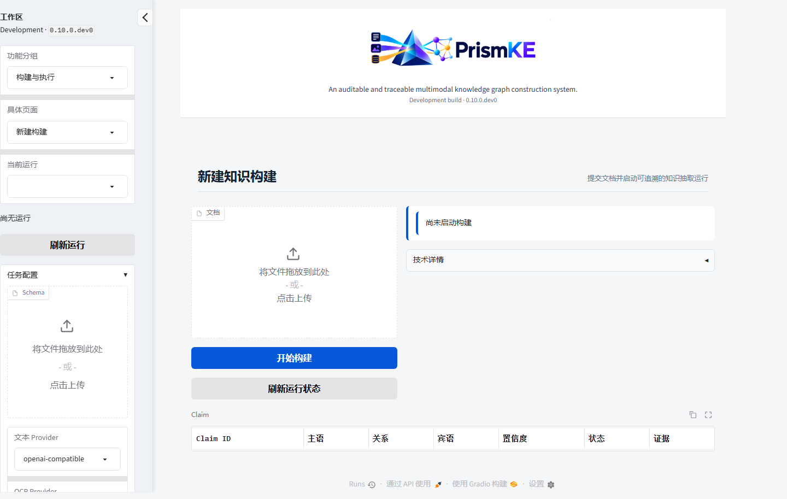
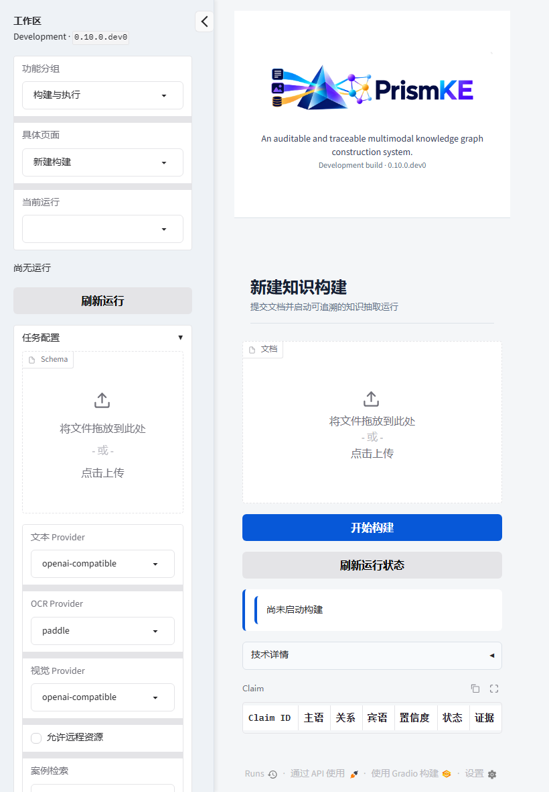
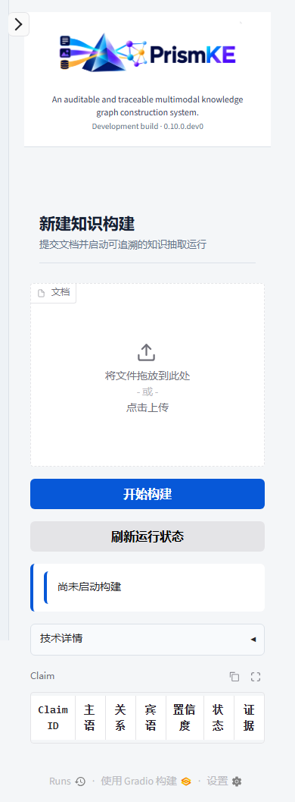

# PrismKE v0.10 前端视觉验收

## 验收范围

本轮在 `dev/v0.10` 上重构 Gradio 研究工作台，不修改后端业务流程、Agent、实体阈值、API 契约或流程协议。页面采用可折叠左侧配置栏、普通顶部品牌区和动态任务工作区；品牌区使用 `assets/branding/prismke-logo-4k.png`。

验收全部使用独立临时运行目录、JSON 图存储、Mock Provider 和 Mock Embedding。没有调用百炼、BGE-M3、OCR、VLM 或生产 Neo4j，也没有替换生产 v0.9.2 服务。

## 页面结构

- 左侧栏按“工作区状态、功能分组、具体页面、当前运行、任务配置、高级策略、模型与图存储”组织。
- 功能分组和具体页面使用两级 `Dropdown`，完整覆盖 15 个页面；单页面分组自动隐藏第二级选择。
- 所有单选审核动作、纠正动作和未知请求核对结论均改为 `Dropdown`；二元确认继续使用 `Checkbox`。
- API Key 和 Neo4j 密码仅显示配置状态，不提供明文显示或编辑控件。
- 右侧顶部品牌区在所有任务间共用且不吸顶；任务页统一为标题栏、状态摘要、主要操作区和默认收起的技术详情。
- 手机端侧栏作为抽屉默认收起，左上角保留展开按钮；桌面和平板默认展开。

## 代表性截图

### 桌面端

### 平板端

### 移动端

15 个页面的逐页桌面截图位于 [`images/v010-ui/pages/`](images/v010-ui/pages/)。其中包括总览、构建、执行、实体审核、事实审核、校验、证据、图谱、实体治理、审核纠正、版本、案例、Reflection、Agent 协作和系统状态。

## 自动验收结果

| 检查项 | 结果 |
|---|---|
| Ruff | 通过 |
| Mypy | 107 个源码文件通过 |
| 完整 pytest | 326 项通过，21 项按环境条件跳过 |
| 前端结构测试 | 15 个页面唯一覆盖；无 `Radio` 组件；敏感字段无明文控件 |
| Playwright | `1440×900`、`820×1180`、`390×844` 通过 |
| 页面导航 | 15 个页面逐页可达，标题与路由一致 |
| 页面溢出 | 三种视口均无页面级横向溢出 |
| Logo | 三种视口均非空，保持比例；移动端最大宽度 250px |
| wheel 构建 | `frontend` 与指定 4K Logo 均包含，原始 Logo 未打包 |
| wheel 安装 | 全新虚拟环境中可导入前端并解析 Logo |

完整测试中的跳过项包括需要专用 Neo4j、外部模型或特定平台条件的用例；它们没有被伪装成通过。专用 Neo4j 验收在服务器隔离实例上单独记录。

## 安全与兼容边界

- `/ui/`、`prismke serve`、FastAPI 路由和现有应用服务保持兼容。
- 页面切换仅改变显示容器，不创建运行、不触发模型调用，也不清空当前运行或表单状态。
- 完整 JSON、请求细节和低频危险操作默认收起；向量、密钥和密码不进入主要视图。
- Logo 安装包规则精确到 `prismke-logo-4k.png`，不会自动纳入同目录其他图片。
- 本轮仍是 `0.10.0.dev0` 开发验收，不代表 v0.10.0 已发布。

## 遗留事项

- Gradio 自带页脚仍保留，后续可在不影响可访问性的前提下评估是否隐藏。
- 空工作区中的按钮会按既有业务规则禁用或返回明确提示；真实任务的数据密度仍需在正式材料审核时继续观察。
- 生产 v0.9.2 未替换；v0.10 的发布、默认端口切换和生产数据接续均需单独确认。
