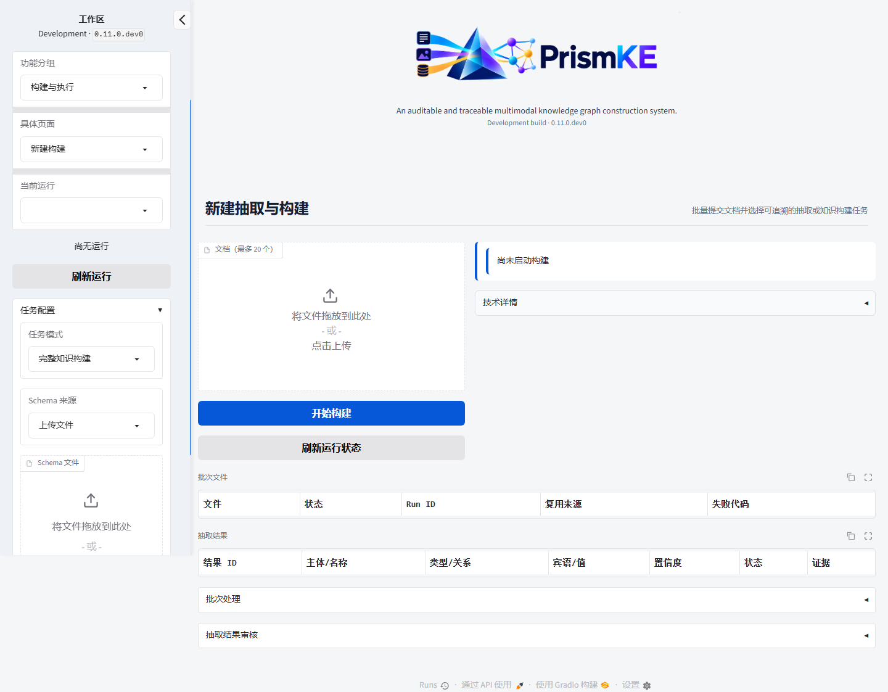
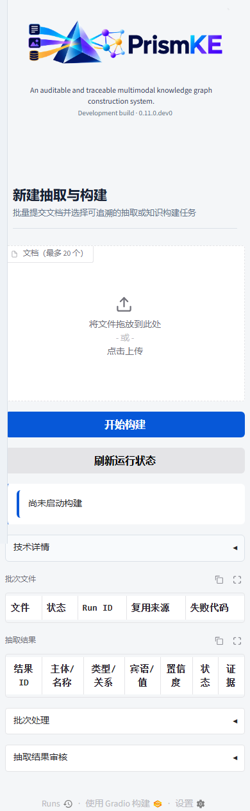

# PrismKE v0.11 隔离验收报告

## 状态

- 分支：`dev/v0.11`
- 软件版本：`0.11.0.dev0`
- 流程协议：`0.11.0`
- 发布状态：未发布
- 生产状态：v0.9.2 保持不变

## 已验证范围

- 六种任务模式及两种关系实体来源。
- 用户提供实体的原文定位、无匹配前置阻断、多处匹配待确认及版本化审核。
- 前五种任务不写 GraphStore，完整知识构建保持显式提交边界。
- TXT、Markdown、HTML、PDF、DOCX、JSON、PNG、JPEG、WebP、TIFF、BMP 解析。
- JSONPath 字段证据回读、值哈希篡改检测和数组顺序。
- 多文件流式上传、批次持久化、重复内容复用、部分失败、重试和排除审计。
- 跨文档重复事实与证据合并、功能关系冲突阻断和排除来源后的单 Revision 提交。
- 属性、事件、事件角色的 Provider 解析、统一校验、人工审核事件与结果导出。
- v0.10 单文件默认行为回归，检查点协议隔离，取消和请求账本复用。
- 研究工作台多文件上传、任务下拉、统一结果表、批次操作，以及非写图模式隐藏提交区。

## 自动检查

本地开发验收结果：

- Ruff：通过。
- Mypy strict：102 个源码文件通过。
- pytest：收集 382 项，360 项通过、22 项按环境条件跳过；其中实时 Neo4j、POSIX 服务脚本和真实 LibreOffice 测试由专用环境另行执行。
- LibreOffice 实际转换：通过。使用真实 Writer/headless 将合成 DOC 转换并由项目解析器读取，派生链的原始哈希、派生哈希和工具版本完整。
- wheel：`0.11.0.dev0` 构建、全新虚拟环境安装、任意目录导入、FastAPI 挂载及 Logo 解析通过。
- Playwright：桌面 `1440×900`、平板 `820×1180`、移动 `390×844` 通过；15 个工作台页面均可由分组导航进入，无页面级横向溢出。

桌面新建任务页：

移动端新建任务页：

## 已知边界

- XLS/XLSX 与 PPT/PPTX 不支持。
- 属性和事件尚未进入正式图模型、Revision 差异和补偿回滚。
- 跨文档冲突首版采用批次阻断及来源排除，不提供批次级逐 Claim 冲突裁决页面。
- 旧 DOC 依赖外部 LibreOffice；转换器不可用时明确失败。
- 本轮不做真实模型联调，不宣称开放域抽取质量或新的 Precision/F1 结果。

## 最终同步

- 服务器 Ruff：通过。
- 服务器 Mypy strict：受 2GB 容器内存上限影响，单进程全量检查被系统终止；改为按模块分组后完整覆盖 102 个源码文件，全部通过。本地单进程全量检查同样通过。
- 服务器完整 pytest：373 项通过、9 项按专用环境条件跳过。
- 服务器隔离 Neo4j：102 项通过；使用独立 `17474/17687` 端口和独立数据目录，测试结束后实例已停止。
- POSIX 服务脚本：13 项通过，默认运行目录已更新为 `runtime/services/v011`。
- LibreOffice：服务器安装 Writer/headless `7.3.7.2`，真实合成 DOC 转换测试 1 项通过。
- 浏览器：服务器桌面、平板、移动与 15 个工作台页面通过；同时修复并行 worktree 测试子进程误载旧前端源码的问题。
- 服务：服务器 `/root/autodl-tmp/PrismKE` 已切换到 `dev/v0.11`，Web、Neo4j 和工作器健康；新运行目录为空，旧 `runtime/services/v010` 保留。
- 同步：本地、GitHub 与服务器均使用 `dev/v0.11`；服务器原有的 Jupyter `.ipynb_checkpoints` 文件继续保留，并由 Git 忽略规则排除。

v0.11 只交付开发分支，不合并 `main`，不创建发布标签；生产 v0.9.2 服务和图谱未替换。
