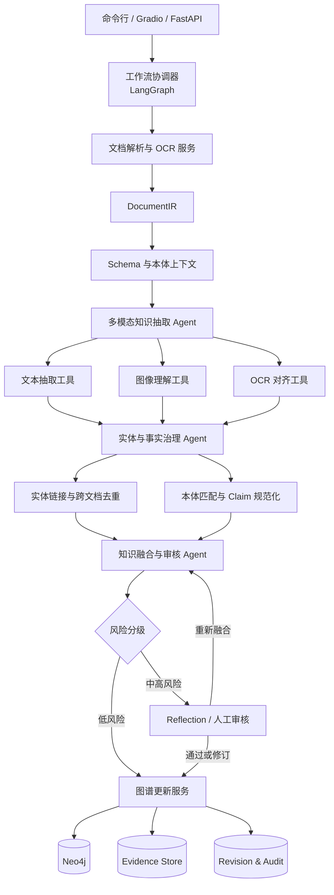

# PrismKE 从零构建计划

> 文档状态：规划稿 v1.0  
> 项目状态：尚未开始编码  
> 目标方向：通用多模态知识抽取与知识图谱构建  
> 预期形态：论文研究系统、可复现实验工程、可交互演示系统

---

## 1. 项目名称与研究定位

### 1.1 项目名称

项目正式名称暂定为 **PrismKE**。

`Prism` 表示“棱镜”：文本、图片、OCR 等异构信息进入系统后，被解析为不同类型的观察和证据，再经过模式约束、实体对齐、事实规范化与冲突融合，最终形成可追溯的结构化知识。

`KE` 表示 Knowledge Extraction。项目虽然最终完成知识图谱构建，但保留 `KE` 更接近 OneKE 的命名方式，也能够避免 `KGC` 在知识图谱研究中被误解为 Knowledge Graph Completion。

建议英文论文标题：

> **PrismKE: A Dockerized Schema-Guided and Evidence-Aware Agentic System for General Multimodal Knowledge Graph Construction**

建议中文标题：

> **PrismKE：一个容器化、模式引导、证据感知的通用多模态知识图谱构建智能体系统**

### 1.2 项目目标

PrismKE 不是面向某个固定领域的畜牧知识图谱系统，也不是只在 OneKE 前面增加一个图片识别模型。它要形成一套通用的、多模态的、可以长期维护的知识图谱构建流程。

系统最终应完成以下闭环：

1. 接收文本、PDF、图片和扫描文档。
2. 保留文档版面、页面、文本位置和图片区域信息。
3. 根据用户 Schema 或本体抽取实体、关系和事实。
4. 对图文抽取结果进行跨模态对齐。
5. 完成实体消歧、实体链接和跨文档去重。
6. 完成实体、关系、单位、时间和事实表达规范化。
7. 对多个来源的支持、补充和冲突知识进行融合。
8. 为每条正式知识保存文本或图片级证据。
9. 将知识以事务方式写入 Neo4j。
10. 支持图谱版本、差异查询、审计与回滚。
11. 通过命令行和网页完成运行、观察、审核与展示。

### 1.3 与三项已有工作的关系

| 来源 | PrismKE 借鉴内容 | 不直接继承的内容 |
|---|---|---|
| OneKE | Schema 引导、案例检索、Extraction、Reflection、多模型配置与多种文本入口 | 固定 Pipeline、纯文本 PDF 表示、裸三元组直接转 Cypher |
| FARM | 协调器、专业职责拆分、本体规范化、知识融合、质量控制与人工修订 | 畜牧领域 Schema、ESIP 实体类别和领域 Prompt |
| Continual MKGC/MSPT | 图文双流、模态平衡、注意力蒸馏和样本回放 | 将训练模型误当成完整图谱治理系统 |

PrismKE 新增的核心能力是 Claim 中心事实表示、三元组级证据、跨文档实体治理、冲突集合、双时态版本和可插拔图存储。

---

## 2. 首版范围与非目标

### 2.1 首版必须完成

- 中英文文本抽取。
- 文本型 PDF 解析。
- 扫描 PDF 与独立图片 OCR。
- 通用图片内容理解。
- Schema 引导的实体与关系抽取。
- 实体链接与跨文档去重。
- Claim 规范化、分组、冲突检测与风险分级。
- Neo4j 图谱写入。
- 文本 span、页面和图片 bbox 级证据溯源。
- 双时态事实与不可变 Revision。
- CLI、FastAPI 和 Gradio 研究演示。
- API 模型与本地模型可切换。
- Conda 开发环境和 Docker Compose 正式部署。

### 2.2 首版只预留接口

- 表格结构化知识抽取。
- 图表坐标轴、图例和数据系列理解。
- 音频、视频与时间片段证据。
- OpenSPG 正式适配器。
- MSPT 式联合训练和持续学习。
- 多用户权限、租户隔离和生产级任务队列。

表格和图表不能在首版 README 中宣称“已经支持”，只能说明适配接口已经定义。

---

## 3. 总体架构

### 3.1 设计原则

PrismKE 采用“少量语义 Agent + 多个确定性工具/服务”的结构。

- Agent 负责语义理解、策略选择、复杂消歧、融合和反思。
- 工具负责 OCR、PDF 解析、哈希、检索、单位转换和格式校验。
- 服务负责数据库事务、证据存储、版本管理和审计。
- 工作流协调器负责状态和路由，默认不调用 LLM。
- 每个 Agent 必须输出结构化对象，不允许使用自然语言作为模块间唯一协议。

### 3.2 简化后的系统布局



### 3.3 为什么不设置更多 Agent

PDF Parser、OCR、实体候选召回、单位转换和 Cypher 写入不应成为独立 LLM Agent。这些任务有明确输入输出，更适合确定性实现。减少 Agent 数量可以降低模型调用费用、串行延迟、状态不一致和调试难度。

系统保留三个核心语义 Agent：

1. 多模态知识抽取 Agent。
2. 实体与事实治理 Agent。
3. 知识融合与审核 Agent。

工作流协调器属于编排层。Graph Update 属于确定性服务，不允许 LLM 自由生成并直接执行任意 Cypher。

---

## 4. Agent、工具和服务职责

### 4.1 工作流协调器

实现方式：LangGraph `StateGraph`。

职责：

- 创建 `run_id` 并初始化共享状态。
- 检测输入格式和启用模态。
- 加载运行配置、Schema 和本体版本。
- 调度解析、抽取、治理、融合、审核和提交节点。
- 保存节点开始时间、结束时间、错误与重试信息。
- 根据置信度和冲突状态执行条件路由。
- 使用 Checkpoint 支持服务器重启后恢复。
- 在人工审核节点暂停并等待用户决策。

协调器不负责：

- 自己解析 PDF。
- 自己执行 OCR。
- 自己判断实体是否相同。
- 自己生成数据库语句。

### 4.2 多模态知识抽取 Agent

输入：`DocumentIR`、`OutputSchema`、案例检索结果和模型配置。

输出：`EntityMention[]`、`CandidateClaim[]` 和抽取轨迹。

内部工具：

- Text Extraction Tool：从文本块中抽取实体、关系、事件和属性。
- Vision Extraction Tool：从图片或局部区域中识别领域对象、属性和关系。
- OCR Alignment Tool：将 OCR 文本映射回页面或图片区域。
- Case Retrieval Tool：检索与当前 Schema、领域和语言相似的 Good/Bad Case。

约束：

- 每个候选实体和事实必须引用 Evidence。
- 图像本身默认作为 `MediaAsset` 证据，而不是领域实体。
- 图中真实对象可以成为领域实体。
- 模型无法确定时输出不确定性，不允许补造缺失证据。

### 4.3 实体与事实治理 Agent

输入：实体提及、候选事实、实体索引、关系词典和本体约束。

输出：规范实体、解析决策、规范 Claim 和治理审核任务。

内部服务：

- Entity Linking Service。
- Cross-document Deduplication Service。
- Ontology Matching Service。
- Claim Normalization Service。
- Unit and Time Normalization Service。

推荐实体解析流程：

`名称/别名精确匹配 → 向量 Top-K 召回 → 类型过滤 → 上下文重排 → 图邻域验证 → link/review/NIL`

实体合并与拆分必须生成可逆操作记录。类型明显冲突的实体不得自动合并。

### 4.4 知识融合与审核 Agent

输入：规范 Claim、历史 Claim、Schema 约束、证据和来源元数据。

输出：融合结果、`ConflictSet`、风险等级与 `ReviewTask`。

主要动作：

- 将描述同一事实的 Claim 放入同一个 Claim Group。
- 判断不同 Claim 是支持、补充、冲突还是模态独有。
- 综合来源可靠性、模型置信度和跨模态一致性。
- 对异常结果调用 Reflection。
- 对中高风险结果创建人工审核任务。
- 将审核结果转为 Good/Bad Case。

### 4.5 图谱更新服务

职责：

- 使用参数化 Cypher。
- 实体幂等写入。
- Claim、Evidence、Document、ConflictSet 和 Revision 批量提交。
- 事务失败整体回滚。
- 重复提交返回原提交结果。
- 创建不可变 Revision。
- 提供版本差异和补偿式回滚。

---

## 5. 标准处理流程

### 5.1 文档接收

系统接收本地路径、网页上传文件或未来 API 上传。接收后立即计算 SHA-256，并根据哈希判断是否为重复文档。

### 5.2 文档解析

- TXT/Markdown：生成连续文本块和字符 span。
- HTML：移除脚本和样式，同时保留标题与段落层级。
- DOCX：保留段落、标题和图片关系。
- 文本 PDF：使用 PyMuPDF 获取页面、文本块和 bbox。
- 扫描 PDF：页面渲染后调用 OCR。
- 图片：保存原图并生成 OCR 与视觉区域观察。

解析失败应以页面为单位记录，不能因为单页失败丢弃整份文档。

### 5.3 Schema 加载

优先级：

1. 用户明确提供的 Schema。
2. 项目 Schema Repository 中的命名 Schema。
3. OneKE YAML 兼容层映射的 Schema。
4. 用户允许时，由模型生成 Schema Proposal，并要求审核后生效。

### 5.4 多模态抽取

文本和图片可并行抽取，最终都转换为统一 `CandidateClaim`。图片与正文通过页码、图注、附近文本和语义相似度对齐。

### 5.5 实体解析与规范化

实体解析先使用规则和索引，候选分数处于灰区时才调用 LLM。关系名称映射到本体关系 ID，时间和单位转换为统一格式。

### 5.6 融合与冲突处理

同一主语、关系、限定条件和重叠有效时间构成事实比较范围。对象一致时合并证据；对象互不兼容时保留多个 Claim，并创建 `ConflictSet`。

### 5.7 风险路由

- 置信度不低于 `0.85`、无冲突且满足硬约束：自动提交。
- `0.55–0.85`、跨模态不一致或证据较弱：进入审核。
- 低于 `0.55`：默认不进入正式图谱，可由人工恢复。
- 本体新增、实体合并/拆分和高风险冲突：始终人工审核。

阈值必须进入配置文件，实验时允许替换。

### 5.8 图谱提交

提交顺序：

`Document → Evidence → Entity → Claim → ConflictSet → Revision`

所有对象在一个逻辑 Revision 中提交。失败时不留下半完成图谱。

---

## 6. 公共数据模型

### 6.1 DocumentIR

必须包含：

- `document_id`
- `source_uri`
- `media_type`
- `sha256`
- `language`
- `pages`
- `text_blocks`
- `media_assets`
- `visual_regions`
- `parse_warnings`
- `parser_version`

### 6.2 EvidenceRef

必须能够定位到以下任一种证据：

- 文本字符 span。
- PDF 页码与 bbox。
- OCR 文本与 bbox。
- 图片文件及局部区域。
- 后续版本的表格单元格或图表元素。

证据同时记录模型、Prompt、Schema、本体和代码版本。

### 6.3 Claim

Claim 是正式事实的核心表示，至少包含：

- `claim_id`
- `subject_id`
- `predicate_id`
- `object_entity_id` 或规范化值
- `qualifiers`
- `confidence`
- `status`
- `valid_from/valid_to`
- `tx_from/tx_to`
- `evidence_ids`
- `revision_id`

没有证据的 Claim 不允许进入正式图谱。

### 6.4 其他对象

- `EntityMention`：文档内原始实体提及。
- `CanonicalEntity`：规范实体及稳定 ID。
- `CandidateClaim`：尚未完成治理的候选事实。
- `ConflictSet`：互不兼容的多个 Claim。
- `ReviewTask`：需要人工处理的决策。
- `GraphRevision`：一次不可变图谱变更。
- `AgentTrace`：Agent 输入摘要、输出摘要、耗时和模型调用信息。

---

## 7. 图数据库模型

Neo4j 首版节点：

- `Document`
- `Evidence`
- `Entity`
- `Claim`
- `OntologyTerm`
- `ConflictSet`
- `Revision`

核心关系：

- `(Claim)-[:SUBJECT]->(Entity)`
- `(Claim)-[:OBJECT]->(Entity)`
- `(Claim)-[:SUPPORTED_BY]->(Evidence)`
- `(Evidence)-[:FROM_DOCUMENT]->(Document)`
- `(Claim)-[:USES_TERM]->(OntologyTerm)`
- `(Claim)-[:IN_CONFLICT_SET]->(ConflictSet)`
- `(Claim)-[:CREATED_IN]->(Revision)`

对于仅包含字符串、数值、日期或单位的宾语，保存在 Claim 的规范值字段中，不强制创建无意义实体。

---

## 8. 技术栈与运行方式

| 模块 | 选择 |
|---|---|
| Python | 3.11 |
| 依赖 | `pyproject.toml` + `uv.lock` |
| 数据校验 | Pydantic v2 |
| 工作流 | LangGraph |
| Checkpoint | SQLite，首版单实例 |
| CLI | Typer |
| 后端 | FastAPI |
| 前端 | Gradio，挂载到 FastAPI |
| PDF | PyMuPDF |
| OCR | PaddleOCR Provider |
| 图像模型 | VLM Provider |
| 本地参考 VLM | Qwen2.5-VL-7B-Instruct |
| 向量模型 | BGE-M3 |
| 图数据库 | Neo4j 5 |
| 测试 | pytest |
| 部署 | Docker Compose |

API 模型通过 OpenAI-compatible 接口接入；本地模型通过 Transformers 接入，后续增加 vLLM。业务代码只依赖 Provider 接口。

---

## 9. 计划中的项目目录

```text
PrismKE/
├── README.md
├── pyproject.toml
├── uv.lock
├── environment.yml
├── Dockerfile
├── docker-compose.yml
├── .env.example
├── configs/
├── docs/
│   └── PrismKE从零构建计划.md
├── examples/
├── src/
│   ├── core/
│   ├── workflow/
│   ├── agents/
│   ├── parsers/
│   ├── providers/
│   ├── governance/
│   ├── fusion/
│   ├── graph/
│   ├── storage/
│   ├── api/
│   ├── web/
│   └── compatibility/
├── tests/
└── experiments/
```

该目录仅作为后续编码约定。当前阶段不创建源代码目录。

---

## 10. 服务器优先的准备计划

### 10.1 推荐服务器基线

- Ubuntu 22.04。
- 单张 24GB NVIDIA GPU 作为本地模型参考配置。
- 内存至少 32GB，推荐 64GB。
- 系统盘只放环境，代码、模型、数据和证据放数据盘。
- 数据盘建议预留 200GB 以上；需要下载多个模型时建议 500GB。
- 开放一个 Gradio/FastAPI 映射端口和一个 Neo4j Browser 映射端口。

### 10.2 推荐服务器目录

```text
/root/autodl-tmp/PrismKE/       # Git工作目录
/root/autodl-tmp/prismke-data/  # 输入与运行数据
/root/autodl-tmp/models/        # 本地模型
/root/autodl-tmp/evidence/      # 原始证据
/root/autodl-tmp/checkpoints/   # LangGraph检查点
/root/autodl-tmp/neo4j/         # Neo4j数据卷
```

### 10.3 环境策略

研发阶段使用 Conda：

- 创建 Python 3.11 环境。
- 安装 uv。
- 由 uv 根据锁文件安装项目依赖。
- 本地模型相关依赖单独放在 `local-models` 可选依赖组。

发布与复现使用 Docker Compose：

- `app` 容器运行 FastAPI、Gradio 和 LangGraph。
- `neo4j` 容器运行 Neo4j 5。
- 模型、证据和数据库使用数据卷，不写入容器层。
- GPU 容器依赖 NVIDIA Container Toolkit。

Conda 主要服务于日常开发；Docker Compose 是 WWW Demo 和开源复现的正式验收方式。

### 10.4 服务器开发安全

- API Key 只放在 `.env`，不得提交 Git。
- 初始密码不得写入 README 和配置示例。
- Neo4j 不直接暴露到公网，优先通过 SSH 端口转发访问。
- 长时间运行使用 tmux。
- 每完成一个阶段提交 Git，数据和模型不进入仓库。

---

## 11. 分阶段开发路线

### 阶段 0：服务器与仓库准备

任务：建立服务器目录、Conda 环境、Git 仓库、依赖锁定策略、Docker/NVIDIA 检查和 Neo4j 测试服务。

产物：环境检查报告、目录规范、初始 README 和部署说明。

验收：GPU、Python、Git、模型缓存和数据盘状态明确；代码仓库可推送；密钥不进入版本控制。

### 阶段 1：工程骨架与工作流状态

任务：建立数据模型、配置系统、日志、异常、Provider 接口和 LangGraph 状态图。

验收：使用模拟节点跑通完整状态流；节点失败后可以重试；进程重启后可以读取 Checkpoint。

### 阶段 2：DocumentIR 与证据基础

任务：实现文本、HTML、DOCX、PDF 和图片 Parser；完成扫描页检测、OCR 回退、原始文件哈希和证据存储。

验收：中英文 PDF 与图片可以生成稳定 DocumentIR；同一文档重复导入保持幂等；证据可以回到页面和 bbox。

### 阶段 3：Schema 引导的多模态抽取

任务：实现 Schema Repository、OneKE YAML 兼容层、文本抽取、图片抽取、OCR 对齐和统一 CandidateClaim 输出。

验收：文本和图片抽取结果遵守同一个 JSON Schema；关闭视觉模态不影响文本流程；错误模型输出不会越过校验层。

### 阶段 4：实体与事实治理

任务：实现别名匹配、向量召回、类型过滤、上下文重排、NIL、跨文档去重、关系映射和时间/单位规范化。

验收：中英文别名可链接到同一实体；不同类型同名实体不误合并；所有合并和拆分均有审计记录。

### 阶段 5：融合、冲突与审核

任务：实现 Claim Group、跨模态支持判断、冲突集合、置信度校准、风险路由、Reflection 和人工审核状态。

验收：冲突值不被覆盖；人工修订可以重新进入融合；审核结果可写入案例库。

### 阶段 6：Neo4j、双时态和回滚

任务：实现 GraphStore、参数化 Cypher、事务、幂等提交、Evidence 关联、Revision、差异和补偿回滚。

验收：事务失败无半写入；每条 Claim 有证据；任意两个 Revision 可比较；回滚不删除历史。

### 阶段 7：CLI、FastAPI 与 Gradio

任务：提供运行命令、任务接口和完整研究演示页面。

Gradio 页面包括：

- 文档上传。
- Schema 和模型配置。
- 运行进度与 Agent 轨迹。
- 候选实体与 Claim。
- 图片/页面证据查看。
- 冲突和实体合并审核。
- Neo4j 图谱展示。
- Revision 历史和差异。

验收：CLI 和网页调用同一应用服务；相同输入得到一致结果；浏览器可以完成上传到写图的闭环。

### 阶段 8：Docker Compose 与复现包

任务：创建应用镜像、Neo4j 服务、数据卷、健康检查、CPU/API 模式和 GPU/本地模型模式。

验收：新服务器依据 README 可以一条命令启动；API 模式不要求 GPU；数据在容器重建后仍然保留。

### 阶段 9：表格、图表与持续学习

任务：实现 TableAdapter、ChartAdapter；随后加入 MSPT 式模态平衡、注意力蒸馏和 Replay。

验收：新增模态不修改 Claim 公共协议；加入新任务后旧任务性能下降受到控制。

---

## 12. CLI、API 与前端边界

CLI 面向实验和批处理；Gradio 面向演示和人工审核；FastAPI 是二者与系统核心之间的程序接口。

计划中的 CLI：

- `prismke run`
- `prismke serve`
- `prismke review`
- `prismke graph-diff`
- `prismke rollback`

计划中的 API：

- 创建构图任务。
- 查询任务状态和轨迹。
- 查询 Claim 与 Evidence。
- 提交审核决定。
- 查询 Revision 差异。
- 创建回滚 Revision。
- 健康检查。

前端不得复制业务逻辑，只展示和调用后端能力。

---

## 13. 测试与验收方案

### 13.1 单元测试

- Pydantic 数据模型校验。
- DocumentIR 序列化稳定性。
- 哈希与幂等 ID。
- Schema domain/range 检查。
- 实体候选排序。
- Claim 分组与冲突判断。
- 双时态区间处理。
- 参数化 Cypher。

### 13.2 集成测试

- 中文文本。
- 英文文本。
- 文本型 PDF。
- 扫描 PDF。
- 单独图片。
- OCR 局部失败。
- API 模型超时。
- 跨文档别名实体。
- 类型不同的同名实体。
- 相互冲突的事实。
- 重复文档和重复提交。
- Neo4j 事务失败。
- 审核暂停和恢复。

### 13.3 端到端测试

同一测试文档分别通过 CLI 和 Gradio 运行，要求产生一致的 Document、Claim、Evidence 和 Revision。

Docker Compose 测试要求从空数据卷启动系统，完成一次构图、一次审核和一次回滚，再验证数据持久化。

---

## 14. 论文实验计划

### 14.1 数据集

- CrossNER：基础实体抽取与跨领域泛化。
- NYT11：关系抽取。
- ContinueMKGC MNER/MRE：图文抽取。
- 自建治理集：同名实体、别名、跨文档重复、冲突、迟到证据和图片证据。
- FARM 数据可获得时作为领域外验证，不将畜牧 Schema 写入通用系统。

### 14.2 指标

- 实体、关系和 Claim F1。
- 实体链接 Accuracy/F1。
- 跨文档去重 B-Cubed F1。
- 规范化 Macro-F1。
- 冲突识别 F1。
- 证据命中率与区域 IoU。
- 置信度 ECE。
- 图约束违规率。
- Revision 差异与回滚正确率。
- 单文档延迟、模型调用次数和费用。

### 14.3 消融实验

- 移除 Schema。
- 移除 Case Retrieval。
- 移除 Reflection。
- 移除实体治理。
- 移除跨模态融合。
- 移除证据强制约束。
- 移除冲突保留。
- 移除模态平衡和 Replay。

### 14.4 对比系统

- 原始 OneKE 文本流程。
- Text-only PrismKE。
- Vision-only PrismKE。
- 无治理的直接三元组写图流程。
- ContinueMKGC 的 MNER/MRE 模型结果。

---

## 15. 面向 WWW Demo 的产物

如果后续考虑 WWW Demo Track，建议提前保留以下产物：

- 可公开访问的在线 Demo。
- 三至五分钟系统演示视频。
- Docker Compose 复现说明。
- 中英文示例文档与预置 Schema。
- 实体链接、冲突审核和证据回溯的完整演示案例。
- 系统架构图和单样本状态图。
- 与 OneKE、FARM、Continual MKGC 的能力对照表。
- 延迟、费用、准确率和人工审核比例统计。
- 失败案例与已知限制。

论文重点不应只描述“增加图片输入”，而应强调：

1. Schema 引导的通用文档多模态抽取。
2. Claim 中心的证据、冲突和双时态统一表示。
3. 实体链接与跨文档知识治理闭环。
4. 少 Agent、强工具、可恢复的状态驱动工作流。
5. 从抽取到审核、写图、追溯和回滚的完整系统。

---

## 16. 主要风险与控制措施

| 风险 | 控制措施 |
|---|---|
| Agent 数量过多 | 保留三个核心语义 Agent，其余改为工具和服务 |
| LLM 输出不稳定 | Pydantic/JSON Schema 校验、重试、Reflection 和审核 |
| 文本压制视觉信息 | 独立候选生成、模态贡献记录，后续加入梯度平衡 |
| 实体误合并 | 类型硬约束、灰区审核和可逆操作日志 |
| 冲突事实被覆盖 | Claim 中心存储与 ConflictSet，不直接更新旧值 |
| 证据丢失 | Evidence 先于 Claim 创建，提交前检查证据闭包 |
| Neo4j 写入污染 | 参数化 Cypher、事务、幂等键和批量校验 |
| 本地模型显存不足 | API Provider 回退、量化配置和按模态加载 |
| Docker 数据丢失 | 代码、模型、证据和 Neo4j 全部使用独立数据卷 |
| 研究范围过大 | 首版锁定文本、图片和 OCR，表格/图表后置 |

---

## 17. 正式开工条件

开始编写代码前，应满足：

- 服务器实例与数据盘位置确定。
- Git 远程仓库确定。
- Python 3.11 和 Conda 可用。
- 是否安装 Docker 与 NVIDIA Container Toolkit 已确认。
- API 模型的测试密钥已经通过环境变量准备。
- 本地参考 VLM 是否需要在首轮下载已确定。
- Neo4j 端口与数据目录确定。
- 本文档经过一次人工确认。

满足以上条件后，从“阶段 0：服务器与仓库准备”开始，不提前实现表格、图表或持续学习模块。

---

## 18. 首版完成定义

PrismKE 首版只有在同时满足以下条件时才算完成：

- 中英文文本、图片和扫描 PDF 可以进入统一流程。
- Schema 能约束实体类型与关系类型。
- 每条正式 Claim 至少关联一条可定位证据。
- 支持实体链接、跨文档去重和 NIL 实体。
- 支持关系、时间、单位和事实规范化。
- 支持冲突保留和风险分级审核。
- 支持 Neo4j 事务写入。
- 支持双时态 Revision、差异与回滚。
- CLI 和 Gradio 共用同一核心流程。
- API 模型与本地模型可配置切换。
- Conda 安装可用于开发。
- Docker Compose 可用于正式复现。
- OneKE 原仓库未被修改。

本文档是后续工程实施和论文系统设计的共同基线。任何扩大首版范围的变更，应先更新本计划并说明对时间、显存、数据和实验的影响。
